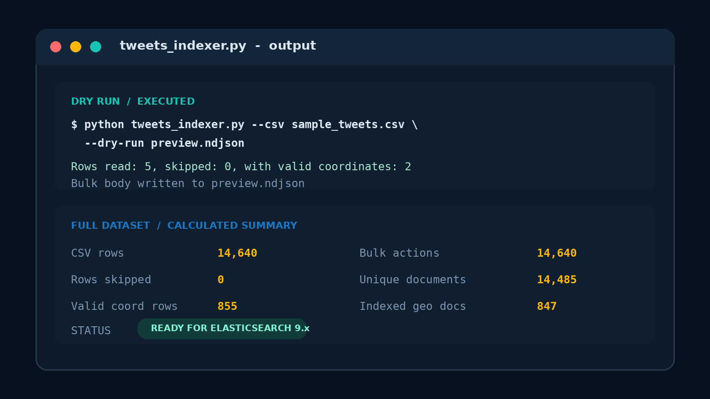
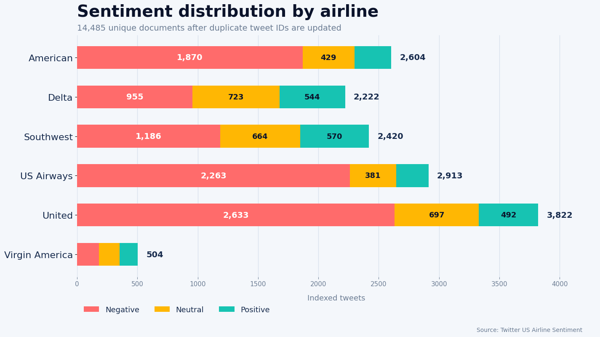
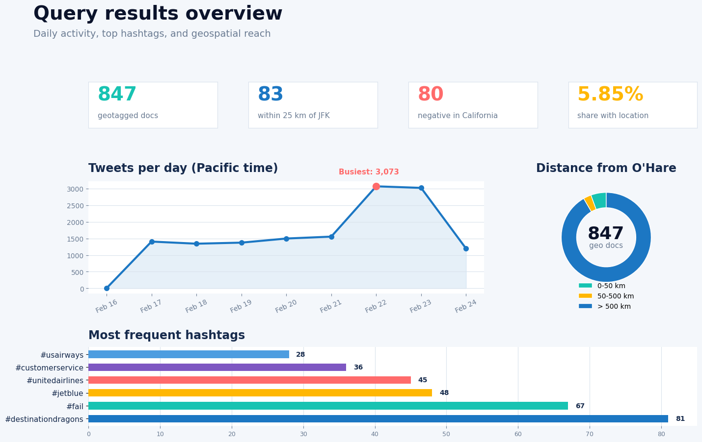

# Airline Tweets Elasticsearch

[](https://www.python.org/)
[](https://www.elastic.co/elasticsearch)
[](LICENSE)

A small data-engineering project that cleans 14,640 airline sentiment tweets,
indexes them in Elasticsearch, and explores them with full-text,
aggregation, and geospatial queries.

## What this project does

- Creates a strict Elasticsearch index with explicit field mappings.
- Converts tweet coordinates into a `geo_point` field.
- Converts timestamps to ISO 8601 while preserving their UTC offsets.
- Unescapes HTML and extracts lowercase hashtags and mentions.
- Skips empty cells and invalid coordinates, including `[0.0, 0.0]`.
- Uses `tweet_id` as `_id`, making repeated runs idempotent.
- Loads documents through the Bulk API in chunks of 500.
- Includes 14 Kibana Console queries covering search, aggregations, and geo analysis.

## Project files

| File | Purpose |
| --- | --- |
| [`tweets_indexer.py`](tweets_indexer.py) | Cleans the CSV and bulk-indexes tweets. |
| [`queries.txt`](queries.txt) | All 14 Elasticsearch queries in Kibana Console format. |
| [`report.pdf`](report.pdf) | Four-page academic report with verified Elasticsearch results. |
| [`docs/results.md`](docs/results.md) | Quick, GitHub-friendly summary of the main findings. |
| [`docs/evidence/`](docs/evidence/) | Actual indexing log, query responses, and verification metadata. |
| [`scripts/verify_analysis.py`](scripts/verify_analysis.py) | Downloads the fixed dataset and runs all queries against Elasticsearch. |
| [`scripts/build_report.py`](scripts/build_report.py) | Rebuilds the PDF using the saved evidence. |
| [`sample_tweets.csv`](sample_tweets.csv) | Five rows for testing without the full dataset. |
| [`compose.yaml`](compose.yaml) | Local Elasticsearch and Kibana services. |
| [`requirements.txt`](requirements.txt) | Python dependency versions. |

## Visual output

The redesigned [academic report](report.pdf) includes readable result tables,
vector charts, source links, and the actual indexing output.

### Indexer output



### Sentiment by airline



### Query results dashboard



## Quick start

### 1. Clone and install

```bash
git clone https://github.com/zaidmoen/airline-tweets-elasticsearch.git
cd airline-tweets-elasticsearch

python -m venv .venv
source .venv/bin/activate  # Windows: .venv\Scripts\activate
pip install -r requirements.txt
```

### 2. Test the cleaner without Elasticsearch

```bash
python tweets_indexer.py \
  --csv sample_tweets.csv \
  --dry-run preview.ndjson
```

Expected output:

```text
Rows read: 5, skipped: 0, with valid coordinates: 2
Bulk body written to preview.ndjson
```

### 3. Start Elasticsearch and Kibana

```bash
docker compose up -d
```

- Elasticsearch: <http://localhost:9200>
- Kibana: <http://localhost:5601>

The included Compose setup disables authentication for local learning only.

### 4. Download the full dataset

Download `Tweets.csv` from the
[Twitter US Airline Sentiment dataset](https://huggingface.co/datasets/osanseviero/twitter-airline-sentiment/blob/main/Tweets.csv)
and place it in the repository root. The dataset is not committed because it
has its own CC BY-NC-SA 4.0 license.

### 5. Build the index

With the included local Compose setup:

```bash
python tweets_indexer.py \
  --csv Tweets.csv \
  --es-url http://localhost:9200 \
  --recreate
```

For a secured Elasticsearch installation:

```bash
python tweets_indexer.py \
  --csv Tweets.csv \
  --es-url https://localhost:9200 \
  --user elastic \
  --password "YOUR_PASSWORD" \
  --ca-cert /path/to/http_ca.crt \
  --recreate
```

An encoded API key can be supplied with `--api-key` instead of a username and
password.

### 6. Run the queries

Open Kibana at <http://localhost:5601>, go to **Dev Tools**, and run the
queries from [`queries.txt`](queries.txt).

Useful checks:

```http
GET /tweets/_count
GET /tweets/_mapping
```

## Results at a glance

| Metric | Result |
| --- | ---: |
| CSV rows | 14,640 |
| Unique indexed documents | 14,485 |
| Valid geotagged documents | 847 |
| Negative tweets | 9,088 |
| Negative United tweets | 2,633 |
| Tweets within 25 km of JFK | 83 |

The source CSV contains 155 repeated-ID surplus rows. Since the indexer uses
`tweet_id` as Elasticsearch `_id`, later copies update earlier documents and
the final index contains 14,485 unique documents. See
[`docs/results.md`](docs/results.md) and [`report.pdf`](report.pdf) for the
complete results.

The full indexer and all 14 queries were executed successfully against
Elasticsearch 9.5.5 on 28 October 2026:
[view the verification run](https://github.com/zaidmoen/airline-tweets-elasticsearch/actions/runs/40709322902).
All 14,640 bulk actions succeeded, with zero failures. The saved
[query responses](docs/evidence/results.json) contain the first five hits per
query; the workflow artifact contains the full responses.

The luggage query now requires both a baggage term and a loss or delay term
(231 hits). The positive `customer service` phrase query returns 91 hits
using the English analyzer.

## Rebuild the report

The PDF uses ReportLab and the DejaVu fonts supplied by most Linux systems.
On Ubuntu, install the fonts with `sudo apt-get install fonts-dejavu-core`.

```bash
pip install reportlab
python scripts/build_report.py
```

This rebuilds `report.pdf` from the saved evidence. To collect fresh responses
from a local Elasticsearch instance first, run `python scripts/verify_analysis.py`.
That script recreates the local `tweets` index and writes new files to `evidence/`;
review them before replacing the report's saved evidence in `docs/evidence/`.

## Index design

| Field | Elasticsearch type |
| --- | --- |
| `text` | `text` with English analyzer and a standard-analyzer subfield |
| `airline`, `airline_sentiment`, `hashtags`, `mentions` | `keyword` |
| `created_at` | `date` |
| `retweet_count` | `integer` |
| `location` | `geo_point` |
| `has_location` | `boolean` |

The mapping uses `dynamic: strict`, so unexpected fields are rejected instead
of silently changing the index schema.

## Dataset and license

The tweet dataset was created by CrowdFlower and is distributed under
[CC BY-NC-SA 4.0](https://creativecommons.org/licenses/by-nc-sa/4.0/).
The code in this repository is available under the [MIT License](LICENSE).
